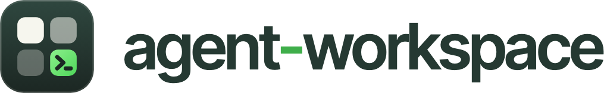

<p align="center">
  <picture>
    <source media="(prefers-color-scheme: dark)" srcset="docs/brand/logo-dark.png">
    
  </picture>
</p>

<p align="center"><b>A workspace of AI agents for the projects you work on.</b><br>
<a href="https://aikagent.github.io/agent-workspace/">User guide</a> · <a href="#quick-start">Quick start</a> · <a href="LICENSE">MIT</a></p>

Clone this repo, run `./setup`, and get an AI-assisted engineering workflow for the projects you work on: one agent per project and role, each with your team's rules, the project's context and only the tools its role allows. A terminal wizard sets everything up.

This repo holds **only structure and the generic workflow**. Your team's data lives in its own private org repo; your personal choices stay on your machine. Nothing is shared back.

**User guide:** https://aikagent.github.io/agent-workspace/ (source: [`docs/index.html`](docs/index.html)).

## Quick start

```sh
git clone git@github.com:aikagent/agent-workspace.git
cd agent-workspace
./setup
```

**You need:** [bun](https://bun.sh) and git. The wizard installs [omp](https://omp.sh) if it is missing (after your yes). [pass](https://www.passwordstore.org/) is recommended for secrets; Tern is optional. Your team lead gives you the URL of your org repo (see [Set up your org repo](#set-up-your-org-repo)).

## The wizard

| # | Step | What happens |
|---|---|---|
| 1 | Tools | Checks git, omp, tern and pass; asks which agent you use (omp recommended); offers to install omp; warns if pass is missing or not initialised. Runs every time. |
| 2 | Sign-in | One-line smoke test; if no model answers, `omp login` opens its provider picker. Runs every time. |
| 3 | Organisation | Clones your team's org repo into `orgs/<id>/`, or skip. |
| 4 | Import | Optional: asks whether you already have a folder of projects. Each entry is proposed as a project (matched to an org project by folder name or git remote, or new) or as data; you adjust, confirm, and everything chosen is copied (see [Import an existing workspace](#import-an-existing-workspace)). |
| 5 | Projects | Pick from the org's projects. Clones each repo, or creates an empty folder for a repo without a url. Existing folders are left as they are. |
| 6 | Agents | Pick roles per project; each becomes a generated agent. A role that loosens its parent is refused, with the reason. |
| 7 | Project context | omp reads each repo headless and read-only and drafts `context.md`. You see the draft and decide; an existing org file is kept unless you replace it. |
| 8 | MCP servers | Finds servers configured for Claude Code, Cursor, Gemini, Windsurf, VS Code, OpenCode and Codex, converts them to omp's format and stores their secrets with pass. |
| 9 | Model routing | Shows each provider's usage; keeps your own setup if omp already routes, otherwise proposes an ordered model list per role. |
| 10 | Notes vault | Uses a vault it finds, one you type, a new one with default folders, or none. Only the folder mapping is recorded. |
| 11 | Verify | ✓/✗ for tools, orgs, projects, agents, vault folders, org words in this repo and every pass reference. A ✗ offers to go back to that step. |
| 12 | Finish | Lists your agents with their launch commands and offers to start the **Main session**: `omp` in this folder. |

**Resume:** progress is saved after each step. If you stop (Ctrl+C), close the terminal or a step fails, the next `./setup` offers *Resume at &lt;step&gt;*. On a finished workspace it offers *Change one step*, *Go through all steps again* (keeps everything set up) or *Launch the Main session*.

**Your yes:** every write outside this folder (your omp MCP config, pass entries) happens only after you confirm it.

## Import an existing workspace

Switching from a folder you already work in (say `~/Code`)? The wizard's Import step brings it over without touching it:
- **Copies only.** Nothing in the source folder is written, moved or deleted. On macOS the copies are APFS clones (instant, no extra disk until a file changes); on Linux, `cp --reflink=auto`.
- **Projects** go to `projects/<org>/<project>/<repo>`; a checkout matched by git remote goes into that repo's folder, and the project's other repos are cloned as usual. A folder the org doesn't know yet becomes a new project in your local org checkout (commit it to the org repo through its review). Git worktrees living next to a repo go next to its copy. **Data** (backups, loose files) goes to `data/`, which git ignores. Two entries that would land in the same folder are refused.
- **Uncommitted work and worktrees come along.** Worktree links are re-pointed so no copy shares a repository with the original; a worktree whose repository you don't import is disconnected (`.git` → `.git.copied`). Absolute symlinks into the source are re-pointed too, and a symlinked entry is copied as a real folder.
- **Paths:** source paths (as typed and resolved) in local config files the copies' git doesn't track (`.env`, `settings.local.json`, `requirements.txt`, …) are rewritten to the copies; tracked files, and files still naming entries you left out, are listed.
- **Python environments** in the copies are rebuilt with uv (the copied one is kept as `<name>.copied`), so installing in a copy never changes the original. An environment whose requirements still name the source is left for you to recreate.
- **Re-runnable:** a resumed or repeated import copies only what's missing and finishes the fixes for copies an interrupted run made. It needs an organisation repo.

Agents for the imported projects are set up in the next steps, as usual.

## After setup

- **Main session:** run `omp` in this folder. It follows the workflow rules in [`AGENTS.md`](AGENTS.md).
- **A project agent:** run the `launch.omp` command from `agents/<org>/<project>/<role>/agent.yml`. With another agent, open it in the agent's `cwd` and give it `role.md` as the first message.
- **Keep it healthy:** `./setup verify` after changes; `./setup` to add a project or agent; `git pull` for tool updates (dependencies refresh on the next run).

## Secrets

Secrets go to pass. When the wizard adds an MCP server, every token or key becomes a `!pass show work/<org>/mcp/<server>/<key>` reference in omp's config, and the wizard runs `pass insert` so you type the value straight into pass; it never sees, prints or copies it. A server with a field that could hold a secret but that the wizard does not know (an OAuth block, for example) is skipped, with the reason. `./setup verify` checks that every referenced entry exists, by name only.

Without pass (or before `pass init <gpg-id>`), the wizard warns on every run and uses environment variable names instead. Provider sign-in stays with `omp login`, which keeps its own credentials.

## Commands

| Command | Does |
|---|---|
| `./setup` | The wizard (resumes where it stopped; run it again to change one step) |
| `./setup check` | Shows which tools are installed |
| `./setup org add <git-url>` | Clones an org repo into `orgs/<id>/` |
| `./setup project add <org>/<project>` | Sets up the project's repos in `projects/<org>/<name>/`: clones each one, or creates an empty folder for a repo without a url; existing folders are left as they are |
| `./setup role add <org>/<project> <role>` | Resolves the role (core → org → project) and writes the agent to `agents/<org>/<project>/<role>/`: `role.md` (context, rules, instructions), `overlay.yml` (tool approvals and MCP isolation for omp), `agent.yml` (launch command and model) |
| `./setup vault find` / `use <path>` / `new <path>` | Uses an existing notes vault, or creates one with the default structure |
| `./setup routing show` / `set <role> <provider/model>…` / `limits <short%> <week%>` / `off` | Shows your providers' usage; sets the models per omp model role for usage-based routing (regenerates the agents) |
| `./setup verify` | Checks everything on disk, including pass references |

## Three levels of roles

A role is defined in **core**, can be specialised by your **org** (`orgs/<org>/roles/`) and again by a **project** (`orgs/<org>/projects/<project>/roles/`). Each level points to its parent with `extends:`, and a project role cannot skip an org role of the same id. Lower levels can only tighten: add denied or prompted tools, read-only paths and must-not rules, turn writes off, or narrow MCP servers. A role that tries to loosen its parent is refused.

| Core role | Does | Model tier (omp) |
|---|---|---|
| `dev` | Changes code in one project, test first, with evidence for every acceptance criterion | `@default` |
| `support` | Read-only investigation that answers a question with evidence | `@task` |
| `reviewer` | Read-only review of a change against standards and against its spec | `@slow` |
| `ops` | Runs approved project scripts and reports their output; changes no files | `@task` |

Set `models:` in `workspace.yml` to pick other models per tier.

On omp, denied and prompted tools are enforced by the generated `overlay.yml` (a read-only role also denies edit, write and ast_edit). The overlay also stops the agent from loading the repo's own MCP config (`.mcp.json` and the like), which the org's MCP lists do not cover; agents get only your user-level MCP servers. Must-not rules, read-only paths and MCP lists are written into `role.md` as instructions. On other agents, everything is instructions.

## Model routing

Off by default: project agents then use your own omp setup. `./setup routing set <role> <provider/model> …` lists, for one omp model role, the models to use in order, across the providers you are signed in to. With routing on:
- **Subagents** get their model from a router (`core/adapters/agent/omp/usage-router/`, loaded with `omp -e`): a provider is skipped at 95% of its short window (e.g. 5 hours) or 80% of its weekly window, and among the rest the one whose short window resets soonest goes first, since that quota expires unused otherwise. A provider with several accounts stays in while one of them is under the limits; providers that report no usage are skipped. Change the thresholds with `./setup routing limits`.
- **The agent's own session** starts on your model for its role and moves down the role's list, in the order you gave: on a provider error such as a usage limit, and before a request once the provider's most-used window has less than `100 − short`% left (omp's `retry.fallbackChains` and usage-aware fallback, written to `overlay.yml`). Your other global fallback chains stay as they are.

If your omp setup already routes subagents with its own extension, keep workspace routing off: both routers would act on every spawn.

## Set up your org repo

For team leads. Copy `core/templates/org/` into a new private repo and fill it in:

| File | Holds |
|---|---|
| `org.yml` | id, name, code hosts with their pull-request tool, tracker |
| `AGENTS.md`, `rules/*.md` | Team rules, written into every agent's `role.md` |
| `projects/<id>/` | `project.yml` (repos, default repo, test commands), `context.md`, `glossary.md`, optional `roles/` |
| `roles/` | Org versions of core roles (tighten only) |
| `mcp/allow.yml`, `mcp/block.yml` | MCP servers roles may use, and ones never offered (globs allowed) |
| `denywords.txt` | Words that must never appear in this public repo; `./setup verify` checks them |

Share its URL with your team; each engineer adds it in the wizard's Organisation step (or with `./setup org add <url>`).

## Layout

```
setup                   entry point
AGENTS.md               workflow rules every agent here follows
docs/index.html         the user guide
core/
  workflow/roles/       core roles: dev, support, reviewer, ops
  adapters/agent/       how generated agents run on omp (overlays, usage router) or any other agent
  templates/org/        start your org repo from this
  templates/notes/      default notes vault structure
  templates/workspace.example.yml
  wizard/cli.ts         the ./setup commands
  wizard/src/           wizard screens (tui.ts), omp calls, workspace import, MCP import, pass, progress, workspace logic
  wizard/test/          tests
orgs/       (gitignored) your org repos
projects/   (gitignored) your project folders
agents/     (gitignored) generated project agents
data/       (gitignored) non-project folders and files brought in by the Import step
workspace.yml (gitignored) your choices and the wizard's progress
```

## Status

Early. Works today: the setup wizard with resume, org/project/role/vault/routing commands, role resolution with tighten-only checks, MCP import with pass, usage-based routing. Planned: delegation between the Main session and project agents, Tern split panes, org skills, more agent adapters.

## Develop

```sh
bun test core/wizard/test
AGENT_WORKSPACE_ROOT=/tmp/ws ./setup …   # run the commands against another workspace folder
```

## License

MIT, see [LICENSE](LICENSE).
